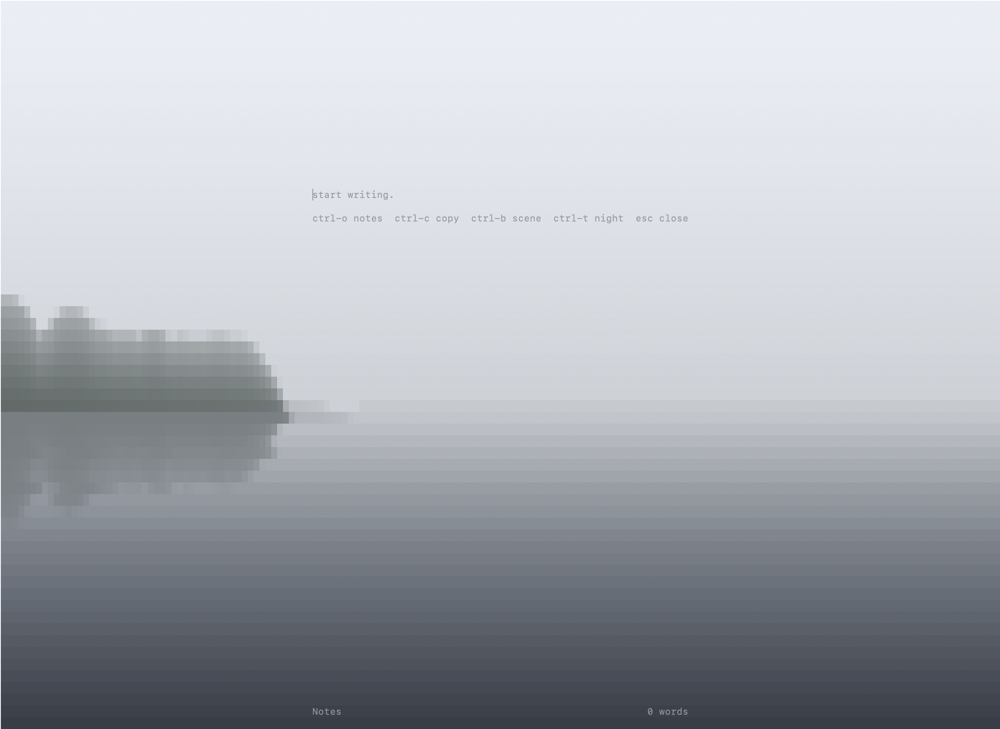

# zenote

A quiet place to write, in the terminal.

Type `notes` and your terminal turns into a still lake in morning fog, with a single narrow column of text in the middle. There are two scenes, both drawn from photos: **lake** (a wooded island and its reflection, the water darkening toward you) and **fog** (nothing but a soft gradient from bright mist to dark water). Each has a day and a night version. No menus, no chrome. Inspired by [OmmWriter](https://ommwriter.com).



Notes are plain markdown files in `~/notes`, so anything else can read them: grep, your editor, or an AI assistant like Claude Code.

## Install

Requires Python 3.8+ and nothing else (standard library only). macOS and Linux.

```sh
git clone https://github.com/magnusohlin/zenote.git
cd zenote
./install.sh
```

`install.sh` symlinks `notes` into `~/.local/bin`. Make sure that directory is on your `PATH`.

## Usage

```sh
notes            # open the last note you had open
notes ideas      # open (or create) a note called "ideas"
notes -l         # list notes, most recent first
notes --dir      # print where notes are stored
```

Inside, just type. Everything saves on its own, about a second after you stop typing and whenever you close.

| Key | |
|---|---|
| `ctrl-o` | switch notes: type to filter, or type a new name to create one |
| `ctrl-c` | copy the selection, or the whole note if nothing is selected |
| `ctrl-z` | undo |
| `ctrl-t` | toggle day / night |
| `ctrl-b` | switch scene: lake / fog |
| `esc` / `ctrl-q` | close |
| mouse | click to place the cursor, drag to select (copied on release), wheel to scroll |
| `option ←/→` | move by word |
| `option ⌫` | delete word |
| `ctrl-a` / `ctrl-e` | start / end of line |
| `ctrl-k` / `ctrl-u` | delete to end / start of line |

Lines starting with `- ` or `- [ ] ` continue as a list when you press Enter. Press Enter on an empty bullet to end the list. Lines starting with `#` are tinted as headings.

Copying gives you the real text: no screen padding, and wrapped lines stay whole.

If a note is changed on disk while it's open (for example by another program), zenote reloads it within a second.

## Using your notes with Claude Code

Since notes are plain files, [Claude Code](https://claude.com/claude-code) can read and edit them. Tell it where they live by adding this to `~/.claude/CLAUDE.md`, which applies to every project:

```markdown
# Personal notes

I keep notes as plain markdown files in `~/notes/<name>.md`, written with the
`notes` terminal app. When I mention "my notes", "the X note", or ask you to
save or add something to a note, read or edit those files directly.
`notes -l` lists them, most recent first. If a note is open in the app while
you edit it, the app reloads it within a second.
```

Then you can say things like:

- "check my ideas note and turn it into a ranked top 5"
- "add a summary of this conversation to my standup note"
- "what did I write about pricing in my notes?"

## Configuration

Environment variables:

| Variable | Default | |
|---|---|---|
| `NOTES_DIR` | `~/notes` | where notes live |
| `NOTES_WIDTH` | `64` | width of the writing column |
| `NOTES_COLOR` | auto | set to `256` if your terminal lacks truecolor |

The scene, day/night choice and last opened note are remembered in `~/notes/.state.json`.

## Notes on terminals

- Truecolor terminals (iTerm2, Ghostty, Warp, WezTerm, kitty, macOS Terminal on macOS 26+) look best. Others fall back to 256 colors.
- `cmd` shortcuts belong to the terminal app, so `notes` uses `ctrl` instead (`ctrl-z`, `ctrl-c`). `cmd-v` paste works.
- A thin strip at the right or bottom edge may show your terminal's own background, because windows are rarely an exact number of character cells. In terminals that support it, zenote tints that strip to match; Warp and macOS Terminal don't support it.

## License

MIT
